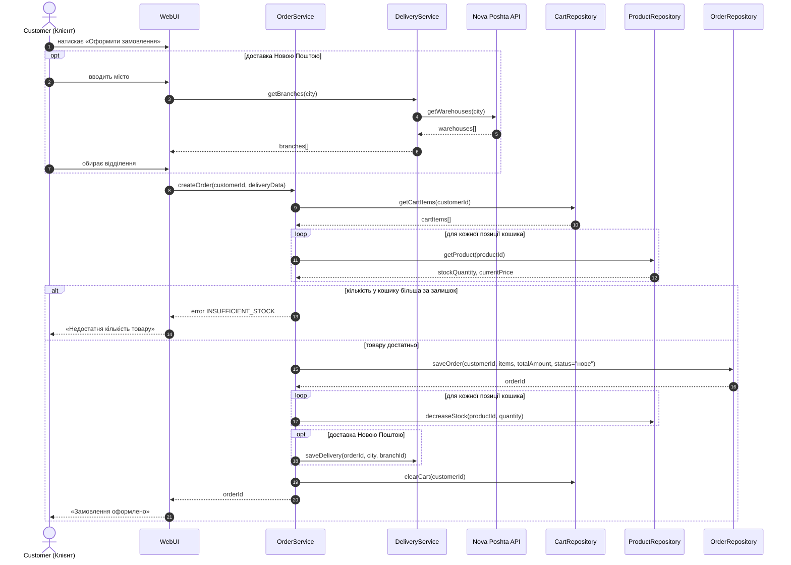
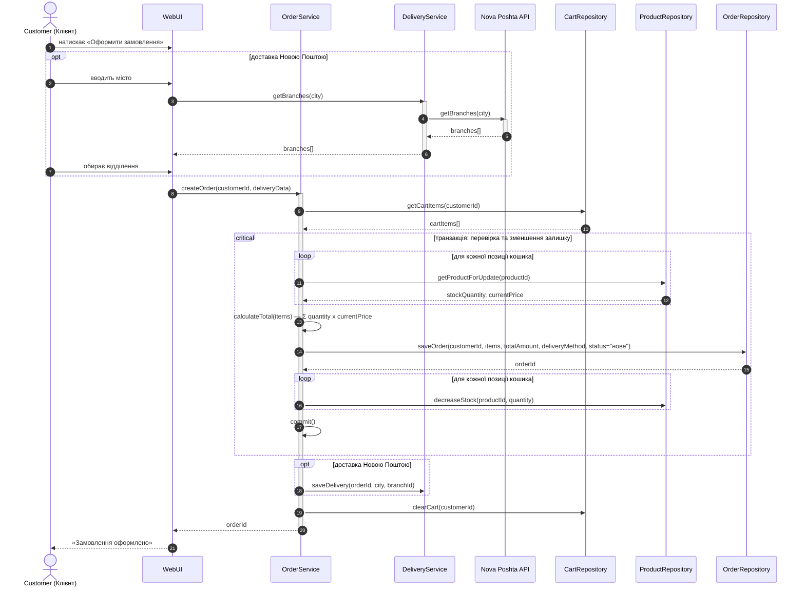
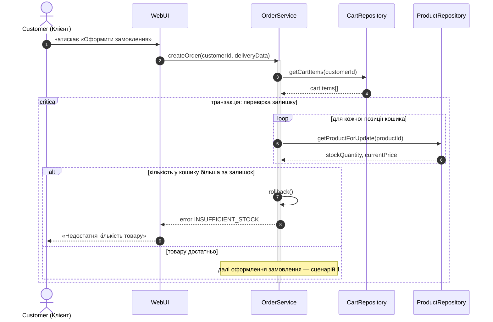

## 1 - будування use case діаграми
**Промт**
>Побудуй use case діаграму спираючись на мій spec.md (Use Case Diagram (PlantUML / Mermaid) з ≥2 типами акторів, include/extend, узагальненням.) зроби в мермейд

**Відповідь від AI**


## 2 - фікс формолювання та статусів
**Промт**
>Можеш виправити розбіжності по статусу замовленя в spec.md readme.md та виправь формулювання в Req там помоему є теж розбіжність, якщо нема то повідомь про це

**Відповідь від AI**
spec.md — у розділі Order замінити рядок статусу
Було: 
>* `status` — поточний стан замовлення (нове, сплачене, доставлене)

Стало:
>* `status` — поточний стан замовлення (нове, сплачене, доставлене, скасоване)

README.md — синхронізувати той самий список
Було:
>* **Відстеження статусів:** контроль життєвого циклу замовлення (нове, сплачене, доставлене)

Стало: 
>* **Відстеження статусів:** контроль життєвого циклу замовлення (нове, сплачене, доставлене, скасоване)

Req-02 та Req-03
> Req-02 - WHILE замовлення перебуває в статусі «нове» й очікує відповіді від платіжної системи, система SHALL блокувати повторні запити на проведення платежів
> Req-03 - WHILE замовлення перебуває в статусі «нове», WHEN клієнт скасовує замовлення в особистому кабінеті, система SHALL змінити статус на «скасоване» і повернути кількість товару до складу

diagram.mmd чіпати не потрібно — поле status там типу string без переліку значень, воно вже універсальне.

## 3 - пояснення матрици трасування
**Промт**
>Поясни простими словами що таке матриця трасування, також поясни вимоги (Матриця трасування: зв'язки багато-до-багатьох (не 1:1); позначити непокриті вимоги/UC.)

**Відповідь від AI**
Смисл простими словами.
Що це взагалі таке
Що це взагалі таке

Матриця трасування — це таблиця-звірка: «яка вимога якими сценаріями/UC перевіряється, і навпаки». Рядки — ваші EARS-вимоги (Req-01...Req-06), стовпці — ваші UC та Gherkin-сценарії. На перетині ставиться позначка (або ●), якщо цей UC/сценарій реалізує/перевіряє цю вимогу.

Навіщо вона потрібна в реальній розробці: щоб відповісти на два питання —

«Ця вимога точно десь реалізована і протестована?» (порожній рядок = вимога висить у повітрі, її ніхто не робив).
«Цей екран/функція точно для чогось потрібна, чи є взагалі вимога, яка її обґрунтовує?» (порожній стовпець = функція без обґрунтування, незрозуміло навіщо вона).

Що конкретно просить завдання

З опису: «матриця трасування «вимога-id ↔ сценарій/UC» як таблиця в Markdown» + «зв'язки багато-до-багатьох (не 1:1); позначити непокриті вимоги/UC».

Це дві конкретні речі:

Зробити таблицю, де рядки — вимоги, стовпці — UC та/або Gherkin-сценарії, і позначити перетини.
Показати, що зв'язки не 1:1 — тобто не повинно бути так, що кожна вимога пов'язана строго з одним UC і навпаки. У вас у житті одна вимога (наприклад Req-04 — перевірка залишку) може перевірятись одразу кількома сценаріями (і happy path, і unhappy path), а один UC (наприклад «оформити замовлення») може реалізовувати одразу кілька вимог одночасно (і про ціну, і про залишок, і про доставку). Це і є «багато-до-багатьох».
Позначити непокриті — тобто чітко написати, які вимоги не мають жодного UC/сценарію (у вас це Req-06, навмисно), і які UC не мають жодної формальної вимоги (у вас це, наприклад, UC-01 «переглянути каталог» — формального Req під це немає).

## 4 - побудова матриці трасування
**Промт**
>Допоможи побудувати матрицю трасування по всім вимогам завдання

**Відповідь від AI**
Вставте цей блок у spec.md після розділу «Use Case Diagram»:
## Матриця трасування

| Вимога/UC | Трасується на | Коментар |
|---|---|---|
| Req-01 | UC-03; US-01 Сценарій 1 | покрита |
| Req-02 | UC-06 | UC є, Gherkin-сценарію немає |
| Req-03 | UC-07 | UC є, Gherkin-сценарію немає |
| Req-04 | UC-03; UC-04; US-01 Сценарій 1 (частково); US-01 Сценарій 2 | покрита кількома сценаріями |
| Req-05 | UC-03 (частково); UC-05; US-02 Сценарій 1 | покрита |
| Req-06 | — | **непокрита**: фоновий процес без UC (див. примітку в EARS) |
| UC-01 | — | немає формальної вимоги (відповідає меті «Зручна навігація каталогом») |
| UC-02 | — | немає формальної вимоги |
| UC-08 | — | немає формальної вимоги (відповідає меті «Відстеження життєвого циклу замовлення») |
| UC-09 | — | немає формальної вимоги |

**Чому багато-до-багатьох:** UC-03 реалізує відразу три вимоги (Req-01, Req-04, Req-05), а Req-04 своєю чергою перевіряється і в UC-03, і в UC-04, і в обох сценаріях US-01 — тобто зв'язок не 1:1 в обидва боки.

## 5 - допомога з додаванням аунтефікації та зручного пошуку (підказки після 3 символів і виправлення помилок у запиті)
**Промт**
>давай додамо аутенфікацію та зручний пошук про який я тобі розповідав та розкажи як це зробити

**Відповідь від AI**
Додаємо дві речі: **автентифікацію** (реєстрація та вхід) і **зручний пошук** (підказки після 3 символів і виправлення помилок у запиті). Зміни потрібні в п'яти місцях. Нумерацію я продовжив від наявних: вимоги з Req-07, UC з UC-10, історії з US-03.

## 1. `spec.md` — EARS-вимоги

Додайте після Req-06:

```markdown
* **Req-07 (Event-Driven):**
WHEN гість надсилає форму реєстрації з ПІБ, email, телефоном і паролем, система SHALL створити обліковий запис клієнта
* **Req-08 (Unwanted Behaviour):**
IF email, вказаний під час реєстрації, вже належить іншому обліковому запису, THEN система SHALL відхилити реєстрацію та повідомити, що цей email вже використовується
* **Req-09 (Event-Driven):**
WHEN користувач вводить email і пароль, що відповідають зареєстрованому обліковому запису, система SHALL авторизувати його як клієнта
* **Req-10 (Unwanted Behaviour):**
IF користувач 5 разів поспіль вводить неправильний пароль, THEN система SHALL заблокувати вхід до цього облікового запису на 15 хвилин
* **Req-11 (State-Driven):**
WHILE користувач не авторизований, система SHALL забороняти оформлення, оплату, скасування та перегляд історії замовлень і перенаправляти його на сторінку входу
* **Req-12 (Event-Driven):**
WHEN користувач вводить у рядок пошуку щонайменше 3 символи, система SHALL протягом 1 секунди показати до 10 підказок серед назв товарів, категорій і брендів, що містять введений текст без урахування регістру
* **Req-13 (Unwanted Behaviour):**
IF за пошуковим запитом не знайдено жодного збігу, THEN система SHALL знайти найближчу за написанням назву товару, категорії або бренду (відмінність не більше ніж у 2 символи), показати результати за нею та повідомити «Можливо, ви мали на увазі: …»
```

Чому саме так:
- Числа («3 символи», «1 секунда», «10 підказок», «2 символи», «5 спроб», «15 хвилин») роблять вимоги вимірюваними й тестованими. Саме цього вимагає критерій «однозначні й тестовані».
- **Req-11 — наскрізна вимога**, вона потрібна майже всім UC клієнта, тож у матриці трасування вона пройде через кілька стовпців.

## 2. `spec.md` — User story та Gherkin

Додайте після US-02:

```markdown
### US-03: швидкий пошук товару
**Як** відвідувач магазину,
**Я хочу** почати вводити назву товару й одразу бачити підказки, навіть якщо помилився в написанні,
**Щоб** швидко знайти потрібну техніку без точного знання назви

**Сценарій 1: підказки після введення трьох символів (Happy path)**
* **Given** у каталозі є товари «iPhone 15» та «iPhone 15 Pro»
* **When** користувач вводить у рядок пошуку «iph»
* **Then** система показує підказки «iPhone 15» та «iPhone 15 Pro»

**Сценарій 2: виправлення помилки в запиті (Unhappy path)**
* **Given** у каталозі є бренд «Samsung»
* **When** користувач вводить у рядок пошуку «samsng» і запускає пошук
* **Then** система показує повідомлення «Можливо, ви мали на увазі: Samsung»
* **And** відображає товари бренду «Samsung»

### US-04: вхід до облікового запису
**Як** зареєстрований клієнт,
**Я хочу** увійти за своїм email і паролем,
**Щоб** оформлювати замовлення та бачити їх історію

**Сценарій 1: блокування після неправильних спроб (Unhappy path)**
* **Given** клієнт має обліковий запис з email «user@mail.com»
* **And** він уже 4 рази поспіль ввів неправильний пароль
* **When** клієнт уп'яте вводить неправильний пароль
* **Then** система блокує вхід до облікового запису на 15 хвилин
* **And** повідомляє, коли можна буде спробувати знову
```

Для US-04 я дав лише unhappy path. У Gherkin повністю розписують 1–2 найкритичніші вимоги, а не все підряд. Успішний вхід тривіальний, а блокування — це те, що реально треба протестувати.

## 3. `spec.md` + `diagram.mmd` — модель даних

Для входу за паролем у `Customer` бракує поля. Без нього Req-09 не буде узгоджена з моделлю даних, а це саме те, що перевіряє пункт аудиту.

У `spec.md`, у `Customer`, після `email`:
```markdown
    * `password_hash` — хеш пароля для автентифікації (пароль у відкритому вигляді не зберігається)
```
І в рядку `email` допишіть: «…для зв'язку та авторизації, **унікальний**».

У `diagram.mmd`, у `CUSTOMER`, після `string email`:
```
    string password_hash
```

Для пошуку нових сутностей не потрібно: він працює по наявних полях `Product.title`, `Category.name` і `Brand.name`. Це варто сказати на захисті як доказ узгодженості з моделлю.

## 4. `use-case.mmd` — діаграма

Тут з'являється проблема. Якщо додати «Зареєструватися», то Customer, який наслідує Guest, міг би зареєструватися повторно, а це неправильно. Тому спільне виноситься в базового актора **User**, від якого наслідуються і Guest, і Customer.

Замініть файл повністю:
```
flowchart LR
    User("User<br/>(Будь-який користувач)")
    Guest("Guest<br/>(Гість)")
    Customer("Customer<br/>(Клієнт)")
    Pay[["Payment API<br/>(зовнішня система)"]]
    NP[["Nova Poshta API<br/>(зовнішня система)"]]

    subgraph System["Онлайн-магазин техніки"]
        UC01(["UC-01 Переглянути каталог"])
        UC02(["UC-02 Відфільтрувати товари"])
        UC10(["UC-10 Шукати товар"])
        UC11(["UC-11 Зареєструватися"])
        UC12(["UC-12 Увійти в обліковий запис"])
        UC03(["UC-03 Оформити замовлення"])
        UC04(["UC-04 Перевірити наявність товару"])
        UC05(["UC-05 Обрати відділення Нової Пошти"])
        UC06(["UC-06 Оплатити замовлення"])
        UC07(["UC-07 Скасувати замовлення"])
        UC08(["UC-08 Переглянути історію та статус замовлень"])
        UC09(["UC-09 Зареєструвати ТТН"])
    end

    Guest ==>|"узагальнення"| User
    Customer ==>|"узагальнення"| User

    User --- UC01
    User --- UC02
    User --- UC10
    Guest --- UC11
    Guest --- UC12
    Customer --- UC03
    Customer --- UC06
    Customer --- UC07
    Customer --- UC08
    Pay --- UC06
    NP --- UC05
    NP --- UC09

    UC03 -. "«include»" .-> UC04
    UC05 -. "«extend» (доставка = Нова Пошта)" .-> UC03
    UC02 -. "«extend» (користувач задає фільтр)" .-> UC01
```

Що змінилося:
- **User** робить те, що доступно всім: каталог, фільтр і новий пошук.
- **Guest** реєструється й входить: це вміє тільки неавторизований користувач.
- **Customer** робить усе, що пов'язано із замовленнями.
- «Оформити замовлення» **не** має `include` на «Увійти». Авторизація тут — передумова, а не крок процесу, тому `include` не малюється. Цю передумову описує Req-11.

Також оновіть розділ «Актори» у `spec.md`: додайте User і змініть опис Customer з «наслідує можливості гостя» на «наслідує можливості User».

## 5. `traceability.md` — нові рядки

Додайте в таблицю:
```
| Req-07 | UC-11 | покрита |
| Req-08 | UC-11 | UC є, Gherkin-сценарію немає |
| Req-09 | UC-12 | UC є, Gherkin-сценарію немає |
| Req-10 | UC-12; US-04 Сценарій 1 | покрита |
| Req-11 | UC-03; UC-06; UC-07; UC-08 | **наскрізна вимога**: без авторизації не працює жоден UC клієнта |
| Req-12 | UC-10; US-03 Сценарій 1 | покрита |
| Req-13 | UC-10; US-03 Сценарій 2 | покрита |
```

Абзац «Чому багато-до-багатьох» доповніть: «Req-11 є наскрізною — від неї залежать UC-03, UC-06, UC-07 і UC-08: якщо авторизація зламана, клієнт не може зробити жодної дії із замовленнями.»

## 6. sequence.mmd - побудова діаграми
**Промт**
> Зроби sequence діаграму в мермейді 

**Відповідь від AI**
# Sequence Diagram: UC-03 «Оформити замовлення»



## 7. adr0003 
**Промт**
>Напиши Ключове рішення — які альтернативи зважив і чому обрав цю (ADR), я якраз заодно створю ADR

**Відповідь від AI**
adr/0003-atomic-stock-decrease.md

# ADR 0003: Атомарна перевірка та зменшення залишку товару

## Контекст
На sequence-діаграмі UC-03 система спочатку перевіряє залишок кожного товару, потім створює замовлення і лише після цього зменшує залишок.
Якщо два клієнти одночасно оформлюють останню одиницю товару, обидва проходять перевірку (залишок = 1) і обидва замовлення створюються, хоча товар один.

## Розглянуті альтернативи

**Варіант A — перевірка і зменшення окремими кроками (як було).**
* Плюси: найпростіша реалізація
* Мінуси: можливий продаж одного товару кільком клієнтам

**Варіант B — зменшувати залишок лише після оплати.**
* Плюси: товар не «займається» неоплаченими замовленнями
* Мінуси: поки клієнт платить, товар може закінчитися, і оплачене замовлення не буде чим виконати; суперечить Req-01 (залишок зменшується при оформленні)

**Варіант C — перевірка і зменшення залишку в одній транзакції під час оформлення.**
* Плюси: один товар неможливо продати двічі; узгоджується з Req-01
* Мінуси: товар резервується ще до оплати; неоплачені замовлення тримають товар, доки їх не скасують

## Рішення
Обрано варіант C: перевірка залишку, створення замовлення та зменшення `Product.stock_quantity` виконуються в одній транзакції. Якщо хоча б для однієї позиції залишку недостатньо, транзакція скасовується і замовлення не створюється (Req-04).

## Наслідки
* На sequence-діаграмі ці кроки виділено блоком `critical` («транзакція»)
* Товар повертається на склад при скасуванні замовлення (Req-03)
* У майбутньому може знадобитися автоматичне скасування неоплачених замовлень через певний час, щоб не тримати товар

## 8. sequence діаграми - розділення на сценарії
**Промт**
> Викладач оновив завдання прочитай та зроби діаграми як потібно по новим вимогам

**Відповідь від AI**
Diagrams/sequence-uc03-success.mmd, Diagrams/sequence-uc03-no-stock.mmd

> sequence-uc03-success.mmd



> sequence-uc03-no-stock.mmd

