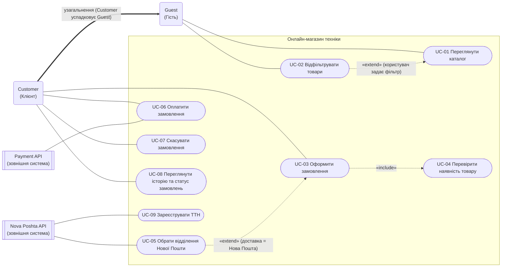

## 1 - будування use case діаграми
**Промт**
>Побудуй use case діаграму спираючись на мій spec.md (Use Case Diagram (PlantUML / Mermaid) з ≥2 типами акторів, include/extend, узагальненням.) зроби в мермейд

**Відповідь від AI**

## 2 - фікс формолювання та статусів
**Промт**
>Можеш виправити розбіжності по статусу замовленя в spec.md readme.md та виправь формулювання в Req там помоему є теж розбіжність, якщо нема то повідомь про це

**Відповідь від AI**
spec.md — у розділі Order замінити рядок статусу
Було: 
>* `status` — поточний стан замовлення (нове, сплачене, доставлене)

Стало:
>* `status` — поточний стан замовлення (нове, сплачене, доставлене, скасоване)

README.md — синхронізувати той самий список
Було:
>* **Відстеження статусів:** контроль життєвого циклу замовлення (нове, сплачене, доставлене)

Стало: 
>* **Відстеження статусів:** контроль життєвого циклу замовлення (нове, сплачене, доставлене, скасоване)

Req-02 та Req-03
> Req-02 - WHILE замовлення перебуває в статусі «нове» й очікує відповіді від платіжної системи, система SHALL блокувати повторні запити на проведення платежів
> Req-03 - WHILE замовлення перебуває в статусі «нове», WHEN клієнт скасовує замовлення в особистому кабінеті, система SHALL змінити статус на «скасоване» і повернути кількість товару до складу

diagram.mmd чіпати не потрібно — поле status там типу string без переліку значень, воно вже універсальне.

## 3 - пояснення матрици трасування
**Промт**
>Поясни простими словами що таке матриця трасування, також поясни вимоги (Матриця трасування: зв'язки багато-до-багатьох (не 1:1); позначити непокриті вимоги/UC.)

**Відповідь від AI**
Смисл простими словами.
Що це взагалі таке
Що це взагалі таке

Матриця трасування — це таблиця-звірка: «яка вимога якими сценаріями/UC перевіряється, і навпаки». Рядки — ваші EARS-вимоги (Req-01...Req-06), стовпці — ваші UC та Gherkin-сценарії. На перетині ставиться позначка (або ●), якщо цей UC/сценарій реалізує/перевіряє цю вимогу.

Навіщо вона потрібна в реальній розробці: щоб відповісти на два питання —

«Ця вимога точно десь реалізована і протестована?» (порожній рядок = вимога висить у повітрі, її ніхто не робив).
«Цей екран/функція точно для чогось потрібна, чи є взагалі вимога, яка її обґрунтовує?» (порожній стовпець = функція без обґрунтування, незрозуміло навіщо вона).

Що конкретно просить завдання

З опису: «матриця трасування «вимога-id ↔ сценарій/UC» як таблиця в Markdown» + «зв'язки багато-до-багатьох (не 1:1); позначити непокриті вимоги/UC».

Це дві конкретні речі:

Зробити таблицю, де рядки — вимоги, стовпці — UC та/або Gherkin-сценарії, і позначити перетини.
Показати, що зв'язки не 1:1 — тобто не повинно бути так, що кожна вимога пов'язана строго з одним UC і навпаки. У вас у житті одна вимога (наприклад Req-04 — перевірка залишку) може перевірятись одразу кількома сценаріями (і happy path, і unhappy path), а один UC (наприклад «оформити замовлення») може реалізовувати одразу кілька вимог одночасно (і про ціну, і про залишок, і про доставку). Це і є «багато-до-багатьох».
Позначити непокриті — тобто чітко написати, які вимоги не мають жодного UC/сценарію (у вас це Req-06, навмисно), і які UC не мають жодної формальної вимоги (у вас це, наприклад, UC-01 «переглянути каталог» — формального Req під це немає).

## 4 - побудова матриці трасування
**Промт**
>Допоможи побудувати матрицю трасування по всім вимогам завдання

**Відповідь від AI**
Вставте цей блок у spec.md після розділу «Use Case Diagram»:
## Матриця трасування

| Вимога/UC | Трасується на | Коментар |
|---|---|---|
| Req-01 | UC-03; US-01 Сценарій 1 | покрита |
| Req-02 | UC-06 | UC є, Gherkin-сценарію немає |
| Req-03 | UC-07 | UC є, Gherkin-сценарію немає |
| Req-04 | UC-03; UC-04; US-01 Сценарій 1 (частково); US-01 Сценарій 2 | покрита кількома сценаріями |
| Req-05 | UC-03 (частково); UC-05; US-02 Сценарій 1 | покрита |
| Req-06 | — | **непокрита**: фоновий процес без UC (див. примітку в EARS) |
| UC-01 | — | немає формальної вимоги (відповідає меті «Зручна навігація каталогом») |
| UC-02 | — | немає формальної вимоги |
| UC-08 | — | немає формальної вимоги (відповідає меті «Відстеження життєвого циклу замовлення») |
| UC-09 | — | немає формальної вимоги |

**Чому багато-до-багатьох:** UC-03 реалізує відразу три вимоги (Req-01, Req-04, Req-05), а Req-04 своєю чергою перевіряється і в UC-03, і в UC-04, і в обох сценаріях US-01 — тобто зв'язок не 1:1 в обидва боки.